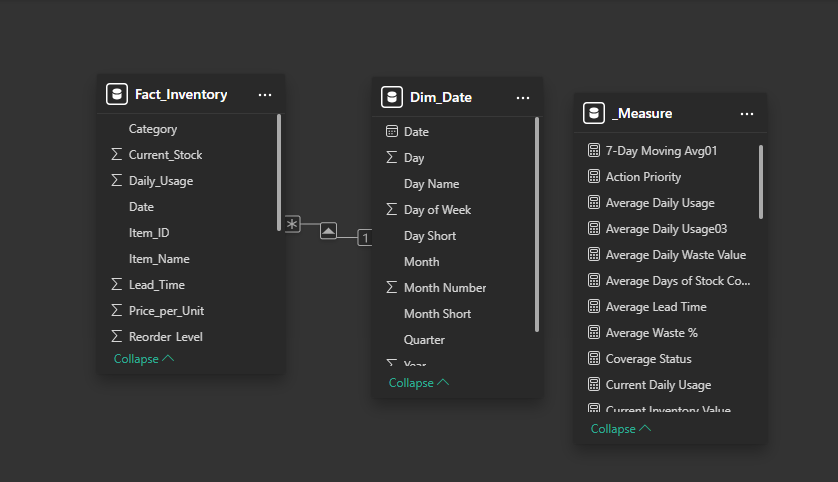
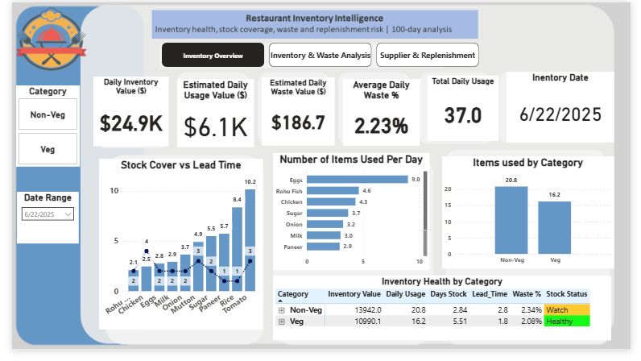
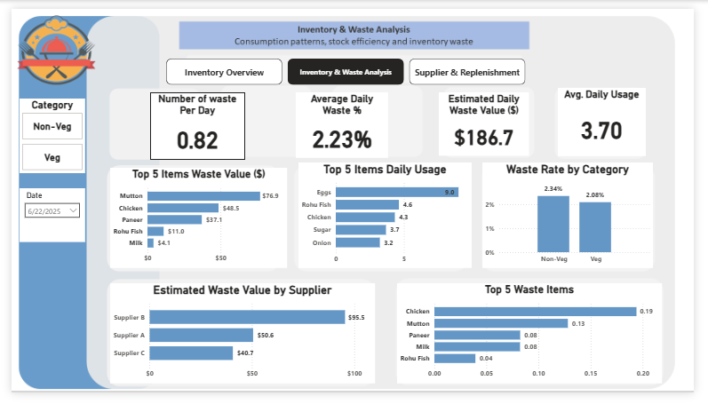
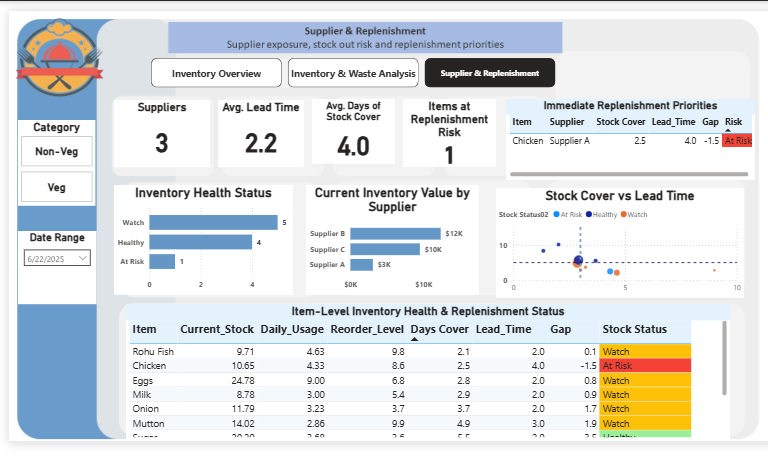

# Restaurant Inventory Intelligence Dashboard | Power BI

An independent portfolio project. I built a three-page Power BI dashboard on 100 days of restaurant inventory data to show which items are close to running out before the next delivery, where waste is concentrated, and how suppliers compare.

## Table of Contents
1. [Project Overview](#1-project-overview)
2. [Dataset](#2-dataset)
3. [Data Model](#3-data-model)
4. [Dashboard Pages](#4-dashboard-pages)
5. [Key Metrics Defined](#5-key-metrics-defined)
6. [Key Findings](#6-key-findings)
7. [Version 2 Corrections](#7-version-2-corrections)
8. [Recommendations](#8-recommendations)
9. [Limitations](#9-limitations)
10. [Author](#10-author)

---

## 1. Project Overview

**Context:** A restaurant needs to keep enough stock to cover each supplier's delivery time without over-ordering or wasting food.

**Problem:** Raw inventory records make it hard to see which items will run out before the next delivery, which items lose the most value to waste, and which suppliers carry the most exposure.

**Approach:** I cleaned and modelled the data in Power Query, wrote DAX measures for stock cover, waste and usage, and built three linked report pages with a date filter and a Veg / Non-Veg category filter.

**Outcome:** A dashboard that gives a clear picture of inventory health for any selected date, with each item marked Healthy, Watch or At Risk.

## 2. Dataset

- 1,000 records: 10 items recorded on each of 100 days (10 June to 17 September 2025)
- 2 categories (Veg, Non-Veg) and 3 suppliers
- 14 fields, including item, category, current stock, reorder level, daily usage, lead time, price per unit, supplier and waste percentage
- `Waste_Percentage` is stored as a whole-number percentage (for example, 2.03 means 2.03%)

Supplier and lead time can change from day to day for the same item, so supplier results describe the selected date.

## 3. Data Model

A star-style model in Power BI:

- **Fact_Inventory:** daily inventory records
- **Dim_Date:** a date dimension linked to the fact table
- **_Measure:** a table holding the DAX measures (for example, stock cover, waste quantity, waste value, average lead time and coverage status)

## 4. Dashboard Pages

All figures below are for **22 June 2025**, the date selected in the screenshots. Every figure changes with the date filter.

### Inventory Overview

- Daily inventory value, estimated daily usage value, estimated daily waste value, average waste % (2.23%), total daily usage (37.0 units across all items) and the selected inventory date
- **Stock Cover vs Lead Time** compares each item's days of cover with its supplier lead time
- **Inventory Health by Category** shows Non-Veg at 2.84 days of stock cover (Watch) and Veg at 5.51 days (Healthy)

### Inventory & Waste Analysis

- Waste quantity per day (0.82 units), average waste % (2.23%), estimated daily waste value and average usage per item (3.70)
- **Top 5 items by waste value:** Mutton, Chicken, Paneer, Rohu Fish and Milk
- **Waste rate by category:** Non-Veg 2.34%, Veg 2.08%
- **Waste value by supplier**, plus top 5 items by daily usage and by waste quantity

### Supplier & Replenishment

- 3 suppliers, 2.2 days average lead time, 4.0 average days of stock cover
- **Inventory health:** 4 items Healthy, 5 Watch and 1 At Risk
- **Immediate replenishment priority:** Chicken from Supplier A, with 2.5 days of cover against a 4-day lead time (a gap of -1.5 days)
- Current inventory value by supplier, and an item-level table of stock, usage, cover, lead time, gap and status

## 5. Key Metrics Defined

| Metric | Definition |
|---|---|
| Days of Stock Cover | Current stock divided by daily usage |
| Gap | Days of stock cover minus supplier lead time |
| Stock Status | At Risk when the gap is below zero, Watch when cover is only slightly above lead time, otherwise Healthy |
| Waste Quantity | Daily usage multiplied by waste percentage |
| Waste Value | Waste quantity multiplied by price per unit |
| Total Daily Usage | Sum of daily usage across all items in the selected period |
| Average Daily Usage | Average of the daily totals across the selected days |

## 6. Key Findings

- **Stock risk (22 June 2025):** 1 of 10 items was At Risk. Chicken had 2.5 days of cover and a 4-day lead time, so it would have run out before replenishment arrived. Five more items were on Watch.
- **Waste is concentrated:** On 22 June 2025, Mutton, Chicken and Paneer made up about 87% of the estimated waste value. Over all 100 days, Mutton, Paneer and Rohu Fish led waste value.
- **Category difference:** Non-Veg had a higher waste rate (2.34%) and lower stock cover (2.84 days) than Veg (2.08% and 5.51 days) on that date.
- **Supplier exposure:** Supplier B carried the largest share of both inventory value and estimated waste value on that date.

## 7. Version 2 Corrections

After the first release, I reviewed the dashboard against the raw data and corrected the following:

- **Waste calculation:** the waste percentage is stored as a whole number, so it must be divided by 100. The first version overstated waste quantity and waste value by 100 times. The corrected version reconciles with the raw file.
- **Consistent date selection:** all three pages now use the same date selection, so the numbers on each page describe the same day.
- **Clearer labels:** KPI cards now say what they measure, for example separating total usage for all items from average usage per item.

## 8. Recommendations

1. **Reorder items whose cover is below their lead time**, and review items on Watch before they become At Risk.
2. **Focus waste reduction on the few items that drive most of the loss**, such as Mutton, Chicken and Paneer.
3. **Review supplier lead times**, especially where a long lead time pushes an item into At Risk.
4. **Set targets** for days of stock cover, waste % and replenishment risk, and review them regularly.

## 9. Limitations

- The dataset covers 10 items over 100 days, so conclusions apply to this sample and not to a whole restaurant's menu.
- Results depend on the selected date. Supplier and lead time change from day to day, so supplier findings describe a single date.
- The analysis shows patterns. It does not explain why waste or stock levels change.

## 10. Author

**Olukunle Oyewale** | Data Analyst

- [LinkedIn](https://www.linkedin.com/in/olukunle034/)
- [Portfolio](https://kunlez01.github.io/kunlez.github.io/)
- [GitHub](https://github.com/Kunlez01)

*Last updated: November 2026*
